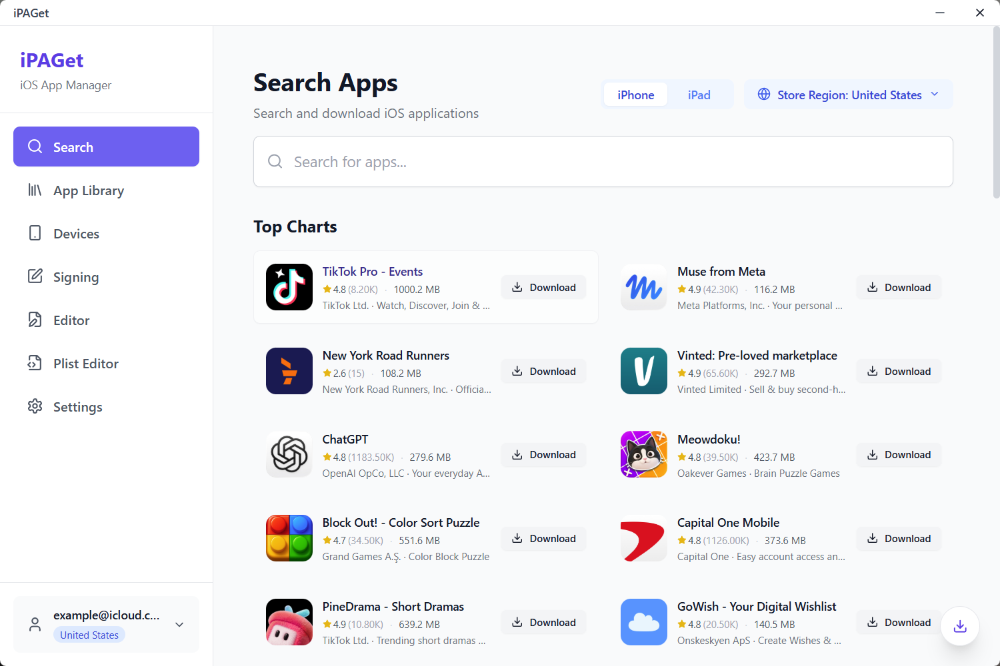
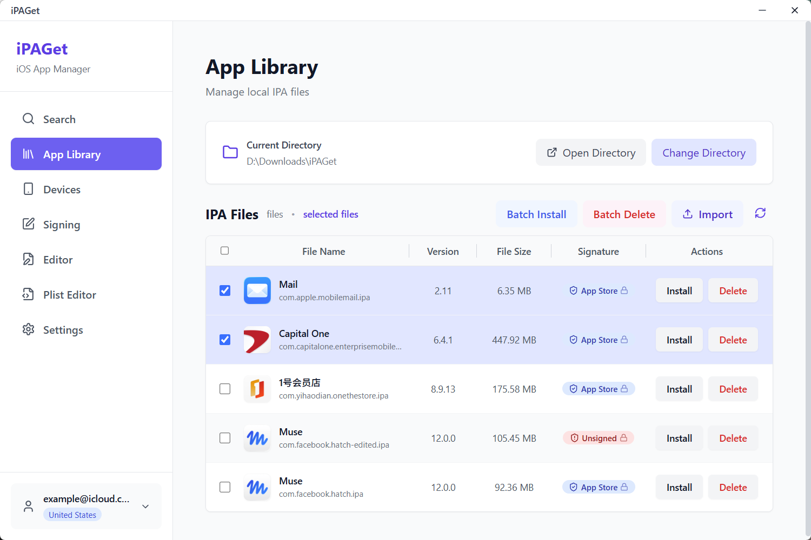
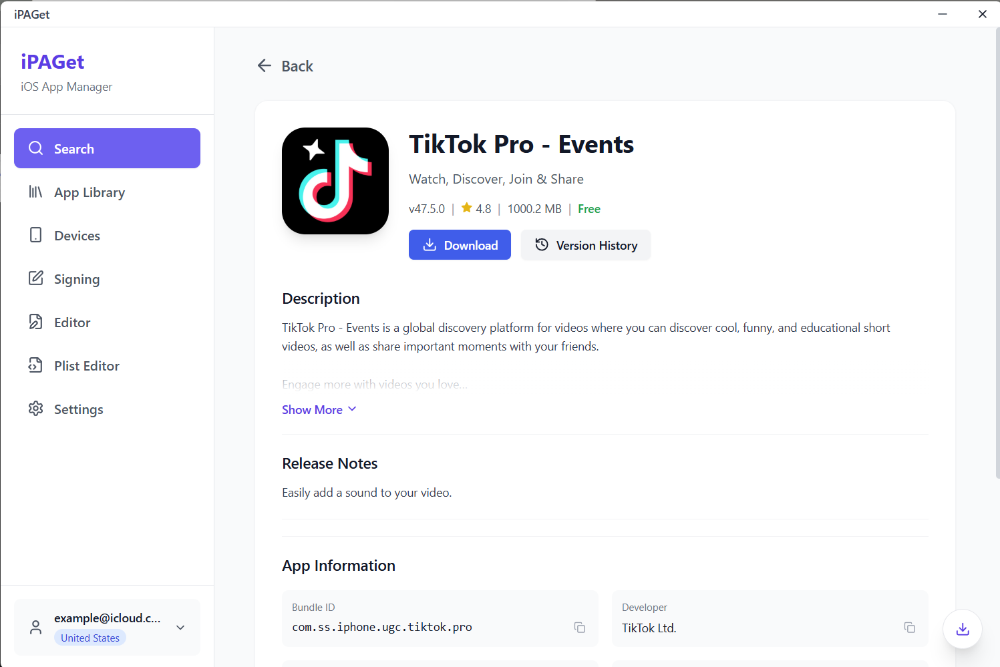
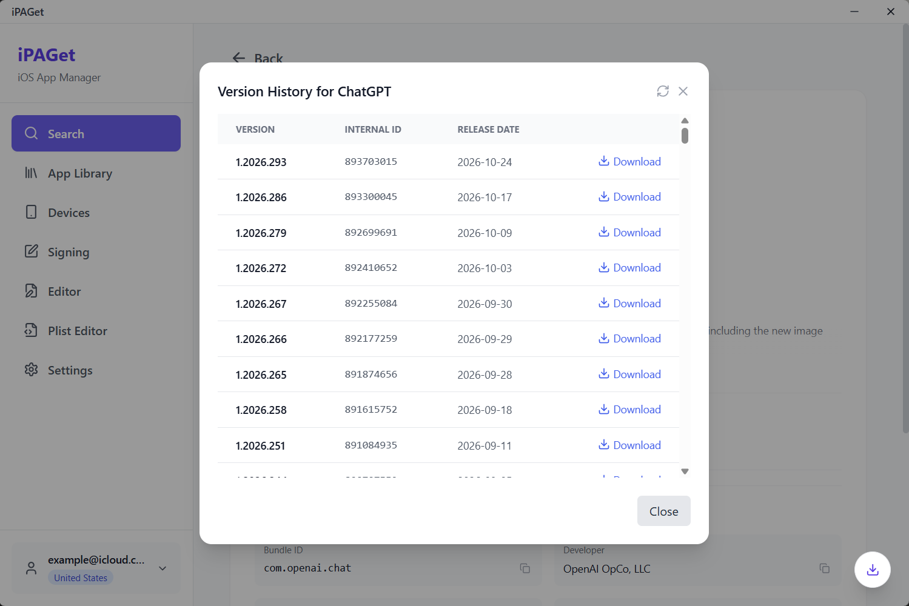
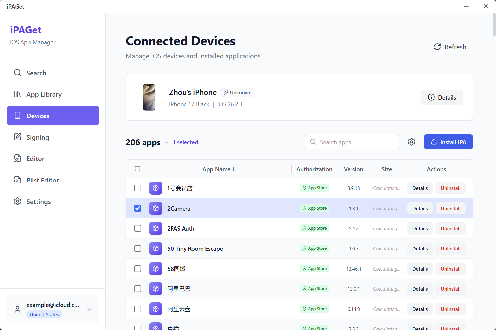
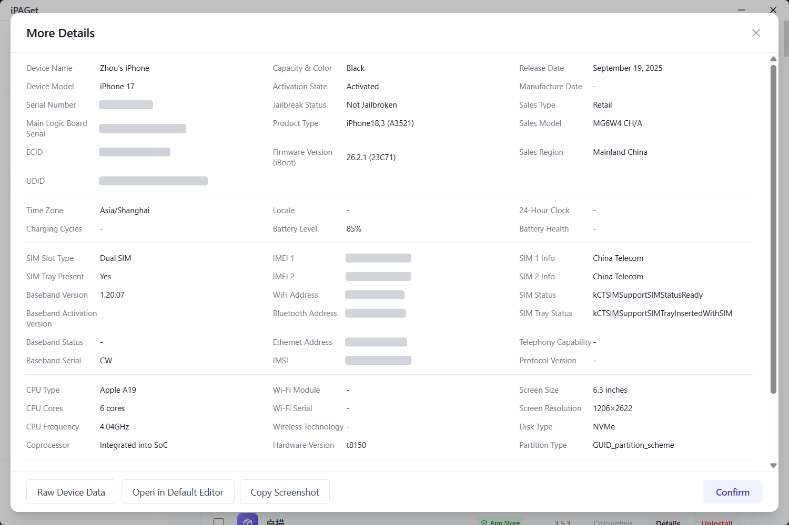
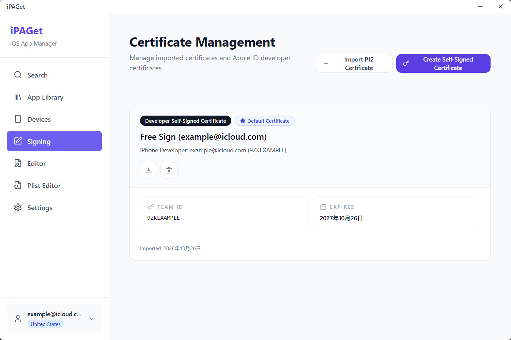
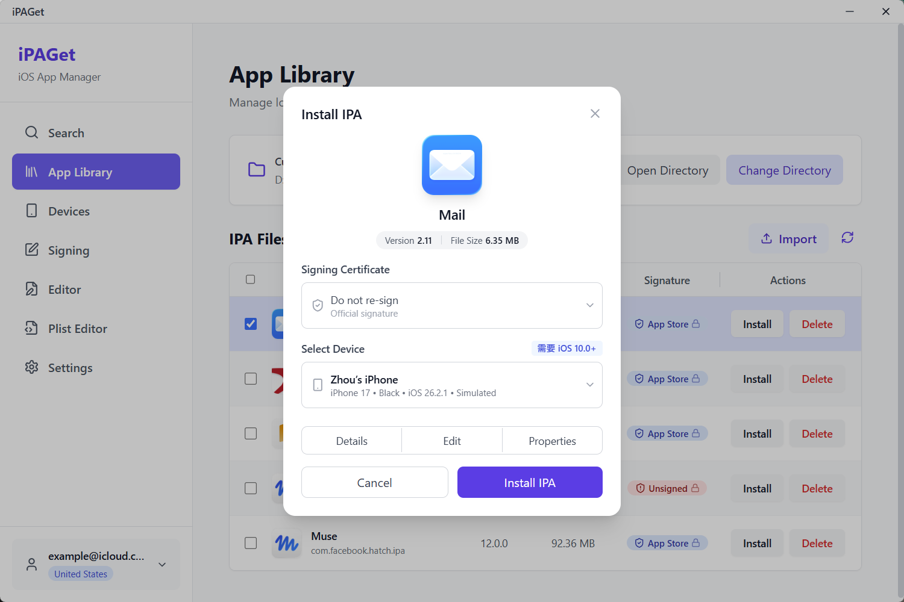
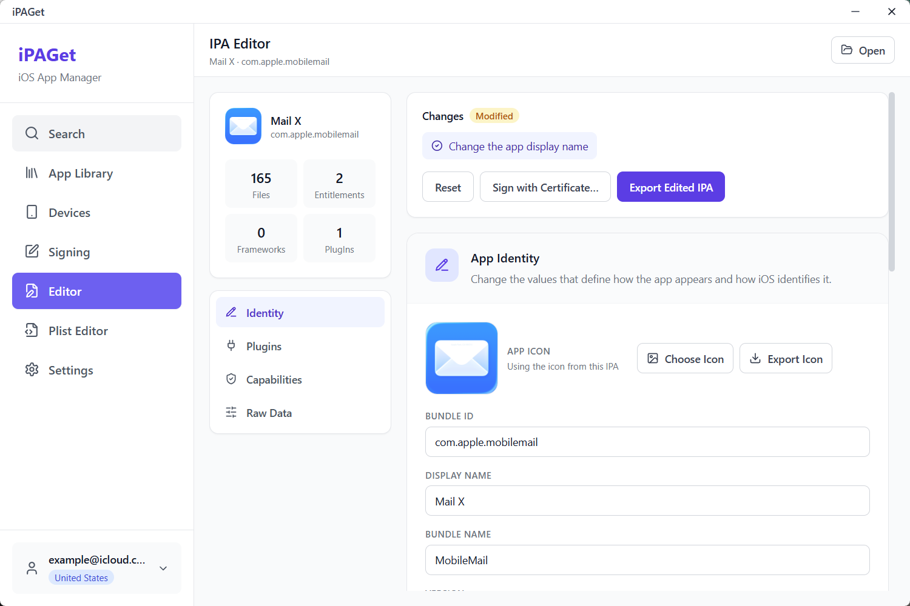
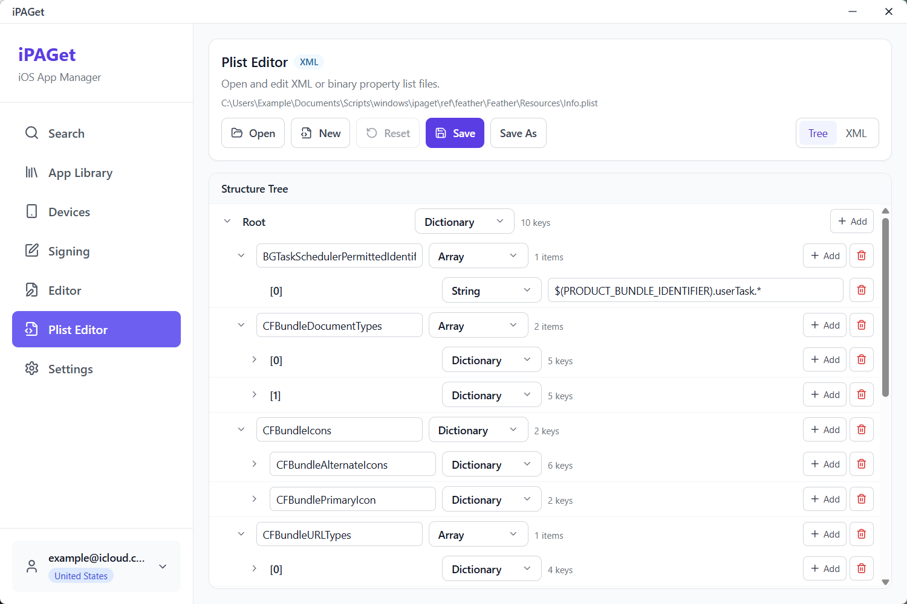

# iPAGet

**Get App Store apps onto your computer without a Mac — and put them back on your phone.**

[](https://github.com/ipaget/ipaget/actions/workflows/build.yml)
[](https://github.com/ipaget/ipaget/releases)
[](https://github.com/ipaget/ipaget/pulls)
<!-- Once the release is published, the download counter works and can replace the commits badge:
[](https://github.com/ipaget/ipaget/releases) -->
[](LICENSE)
[](#download)
[](https://github.com/ipaget/ipaget)
[](https://github.com/ipaget/ipaget/issues)
[](https://github.com/ipaget/ipaget/commits/master)

[](https://v2.tauri.app/)
[](https://www.rust-lang.org/)
[](https://go.dev/)
[](https://react.dev/)
[](https://www.typescriptlang.org/)

[中文说明 / Chinese README](README.zh-CN.md)

**Download App Store apps on your PC without a Mac, and install them back on your phone.**

The App Store hands you the latest build, on the phone, and that is it. Keeping an older version,
looking inside an IPA, swapping the icon, signing it with your own certificate: each one needs a
separate tool, and most of them only run on macOS.

iPAGet folds those jobs into one desktop app. Search any storefront, download an IPA including the
historical build you ask for, install or uninstall it on a connected iPhone, edit the package,
re-sign it. There are builds for Windows, macOS and Linux, and no jailbreak is needed.

Your Apple ID, two-factor codes and signing keys stay on this machine; requests go straight from
your computer to Apple, with no third-party server in between.

---

## Screenshots

| | |
| :-: | :-: |
|  |  |
| Search another storefront; charts, ratings and sizes in one list | Downloaded IPAs live here — install them in bulk, or delete them |
|  |  |
| App details and release notes, with the download right there | Every build of an app: install whichever one you need |
|  |  |
| The phone's installed apps, with search, uninstall and install | Model, baseband, SIM and hardware on one screen (identifiers redacted) |
|  |  |
| Certificates issued by your developer account, plus self-signed ones | Pick the certificate and the target device first |
|  |  |
| Rename, re-icon, toggle capabilities, then export or re-sign | Edit Info.plist as a tree, or just write the XML |

---

## Download

Pick the file for your system from the [latest release](https://github.com/ipaget/ipaget/releases) —
the platform is in the file name, for example `iPAGet_1.0.0_windows-x64.msi`. One file per system is
all you need.

| System | Recommended | Alternatives |
| --- | --- | --- |
| Windows 10/11, 64-bit | `iPAGet_<version>_windows-x64.msi` | `iPAGet_<version>_windows-x64-setup.exe` (NSIS installer), `iPAGet_<version>_windows-x64-portable.exe` |
| Windows 10/11, 32-bit | `iPAGet_<version>_windows-x86.msi` | `iPAGet_<version>_windows-x86-setup.exe`, `iPAGet_<version>_windows-x86-portable.exe` |
| macOS, any Mac | `iPAGet_<version>_macos-universal.dmg` | `iPAGet_<version>_macos-universal.app.zip` (only when the DMG is missing) |
| Linux, 64-bit | `iPAGet_<version>_linux-amd64.AppImage` | `iPAGet_<version>_linux-amd64-portable` |

You will run into these warnings:

- **macOS** builds are not signed or notarized. On first launch use **right-click → Open**, or run
  `xattr -dr com.apple.quarantine /Applications/iPAGet.app`.
- **Windows** may show a SmartScreen warning for the same reason: choose **More info → Run anyway**.
- **Linux** AppImage: `chmod +x iPAGet_<version>_linux-amd64.AppImage` and run it. It is built on
  Ubuntu 24.04, so it needs glibc 2.39 or newer (Ubuntu 24.04+, Debian 13+, Fedora 40+).

---

## What it does

### Store and downloads

- Search by storefront (US, CN, JP, GB and more) with top charts, subtitles, ratings and genres, or
  jump straight from an app's page to its download.
- See the full **version history** before downloading and pick any build you want, including the one
  installed on your phone right now: matched by App Store build ID, not guessed from a version
  string.
- Stay signed in to several Apple Accounts at once; sessions are cached, so you are not typing a
  verification code on every launch.
- Downloads show progress, transferred size and speed, and land in the app library.

### Devices

- Plug in a device and see model, iOS version, storage, battery and how it is connected.
- List the installed apps with their sizes, read the App Store ID each one carries, and download
  that same build.
- Install an IPA, uninstall an app, browse an app's container and move files in or out.

### Packages

- Inspect an IPA before installing: bundle ID, version and build, minimum iOS, supported devices,
  embedded profile, entitlements, dylibs and frameworks, and whether the binary is encrypted.
- Edit `Info.plist` and other property lists in a tree view, or as raw XML.

### Signing

- Issue a certificate from your Apple developer account — a free account works — or import one you
  already have.
- Sign or re-sign an IPA with a certificate and profile, ready to install.
- Keys live in the OS keychain; the app uploads nothing to a server of its own.

---

## Before you start

- Anything that talks to the App Store needs an Apple Account. Local-only work (seeing installed
  apps, browsing files, installing an IPA you already have) does not.
- You can only download apps your account holds a licence for. Even free apps have to have been
  "acquired" once in the store, otherwise the download fails on licensing.
- You need an iOS device on USB that has been trusted on the phone.
- Some operations on iOS 17 and newer go through an usbmux tunnel and need administrator rights: put
  `wintun.dll` next to the app on Windows, start it with `sudo` on macOS and Linux.
- If you are behind a proxy, set it in **Settings**. It takes effect immediately, no restart.

---

## Build from source

Prerequisites: **Node 20+** with **pnpm 9**, **Rust** (stable), **Go 1.25+**, and the
[Tauri system dependencies](https://v2.tauri.app/start/prerequisites/) for your platform
(WebKitGTK 4.1 and `libwebkit2gtk-4.1-dev` on Linux, Xcode command line tools on macOS,
MSVC build tools on Windows).

```bash
git clone https://github.com/ipaget/ipaget.git
cd ipaget
git submodule update --init go-service/vendors/go-ios   # required: replace target of go.mod
pnpm install
pnpm tauri:dev                                          # Vite + Tauri, Go service hot-reloads
```

`pnpm tauri:dev` runs the desktop app against the Vite dev server and lets the Rust shell start the
Go service (through `air`, so Go changes reload without restarting the window). A dev supervisor
keeps the Vite server alive when the app restarts from the in-app debug tools.

Build installers locally:

```bash
pnpm tauri build        # runs scripts/prebuild.mjs: frontend + Go service, then bundles
```

Checks:

```bash
cd go-service && go test ./internal/... && go build ./...
npx tsc --noEmit
node --experimental-strip-types --test scripts/subtitle-scheduler.test.mjs
```

Linux build dependencies (the set used by CI):

```bash
sudo apt-get install -y libgtk-3-dev libayatana-appindicator3-dev libwebkit2gtk-4.1-dev \
  patchelf librsvg2-dev desktop-file-utils appstream libpipewire-0.3-dev libdbus-1-dev \
  libxcb1-dev libxcb-randr0-dev libxcb-shm0-dev libxcb-xfixes0-dev libxcb-shape0-dev \
  libxrandr-dev libgbm-dev libdrm-dev libwayland-dev libxkbcommon-dev libegl1-mesa-dev \
  libxdo-dev libssl-dev pkg-config
```

---

## Repository layout

| Path | Contents |
| --- | --- |
| `src/` | React UI: pages, components, stores and `zh` / `en` locales |
| `src-tauri/` | Tauri shell: window and startup handling, file system and desktop commands, bundling |
| `go-service/` | Go service: App Store access, device communication, IPA parsing, signing, log streaming |
| `docs/images/en` | Screenshots used by this README |
| `docs/images/zh` | Screenshots used by the Chinese README |
| `scripts/` | Dev runner, dev-restart supervisor and the release pre-build step |
| `ref/` | Reference sources read while implementing protocols — not part of the build |

The UI and the service talk over a local HTTP API plus a WebSocket for logs; the service is bundled
inside the app, so there is nothing else to install.

---

## Troubleshooting

| Symptom | What to do |
| --- | --- |
| A verification code is requested again after signing in | The session was cleared or expired. Check **Debug → Sign-in session** to see what is stored, or clear it and sign in again. |
| Device is not listed | Reconnect the cable, accept **Trust This Computer**, unlock the device, and make sure the Apple USB drivers are installed on Windows. |
| Installing or browsing fails on iOS 17+ | Start the tunnel with administrator rights (`wintun.dll` on Windows, `sudo` on macOS/Linux). |
| Version history takes about a minute the first time | The App Store needs a signed download-authorization handshake before it lists builds; results are cached for an hour, and the dialog has a refresh button. |
| Downloads fail with connection errors | An unreachable proxy in **Settings** blocks App Store requests. Clear it or point it at a working proxy. |
| macOS refuses to open the app | Right-click → **Open**, or remove the quarantine attribute as shown above. |

---

## License

iPAGet is released under **CC BY-NC-SA 4.0** — see [LICENSE](LICENSE). You may use, modify and share
it for non-commercial purposes, provided you give attribution and keep derivative works under the
same license. Commercial use is not permitted by this license.

---

## Acknowledgements

iPAGet builds on the work of others:

- [ipatool](https://github.com/majd/ipatool) — App Store authentication and download protocol
- [go-ios](https://github.com/danielpaulus/go-ios) — device communication over usbmux and lockdown
- [Tauri](https://v2.tauri.app/), [React](https://react.dev/) and [Vite](https://vite.dev/) — the desktop shell and interface
- The projects collected under `ref/`, which were read while implementing the protocols above

Apple, App Store, iPhone and iPad are trademarks of Apple Inc. This project is not affiliated with
Apple.
