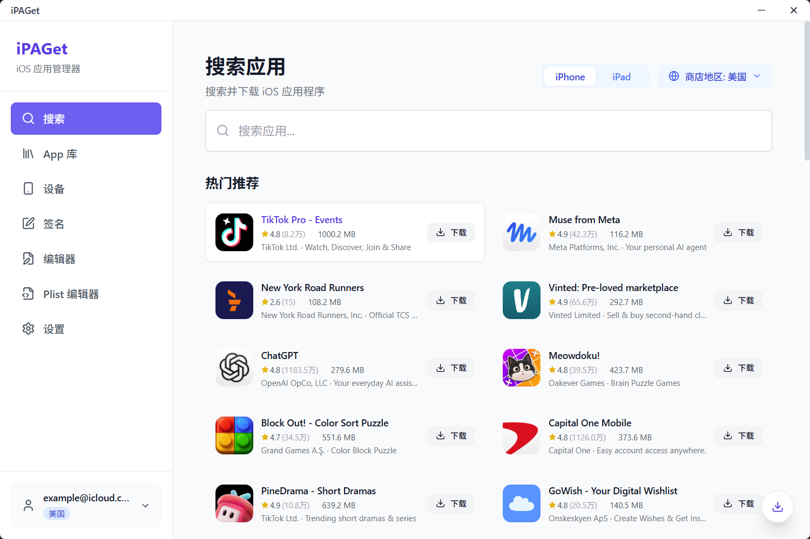
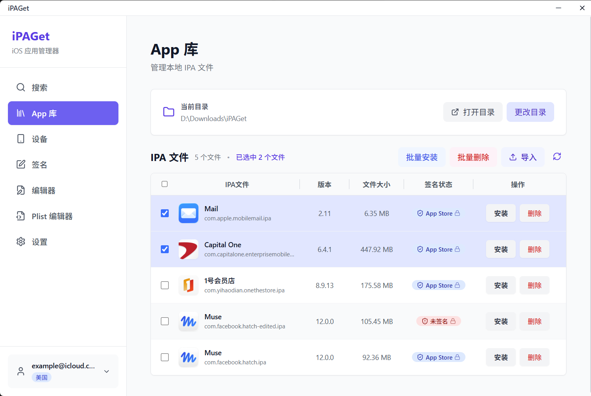
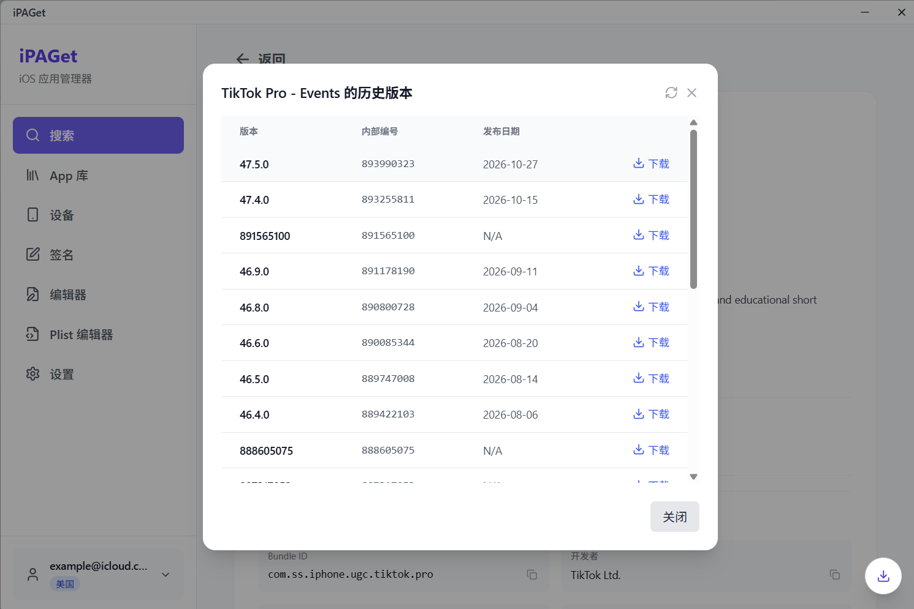
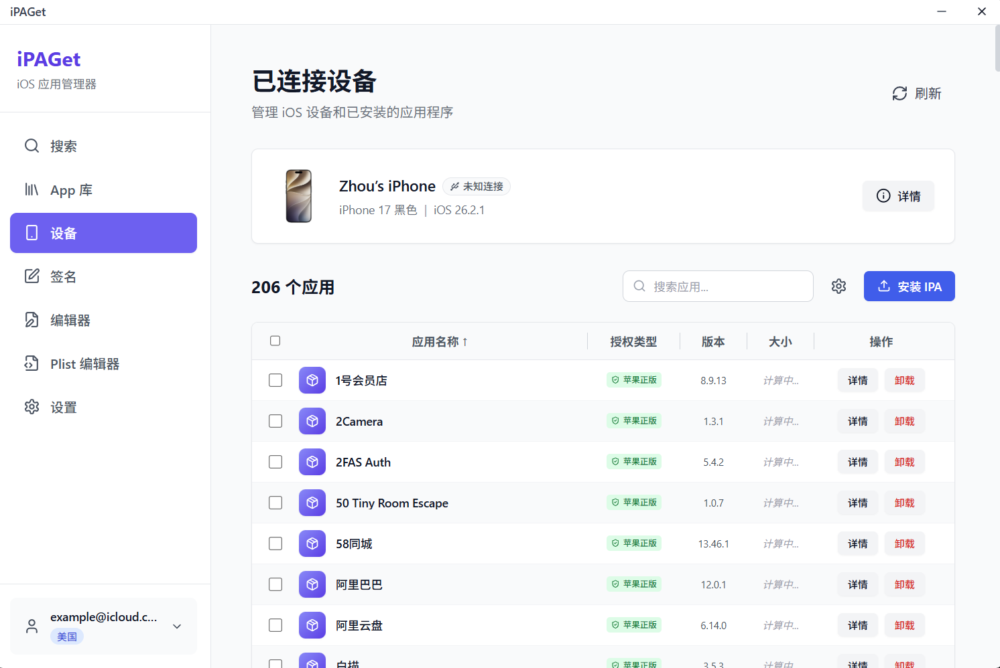
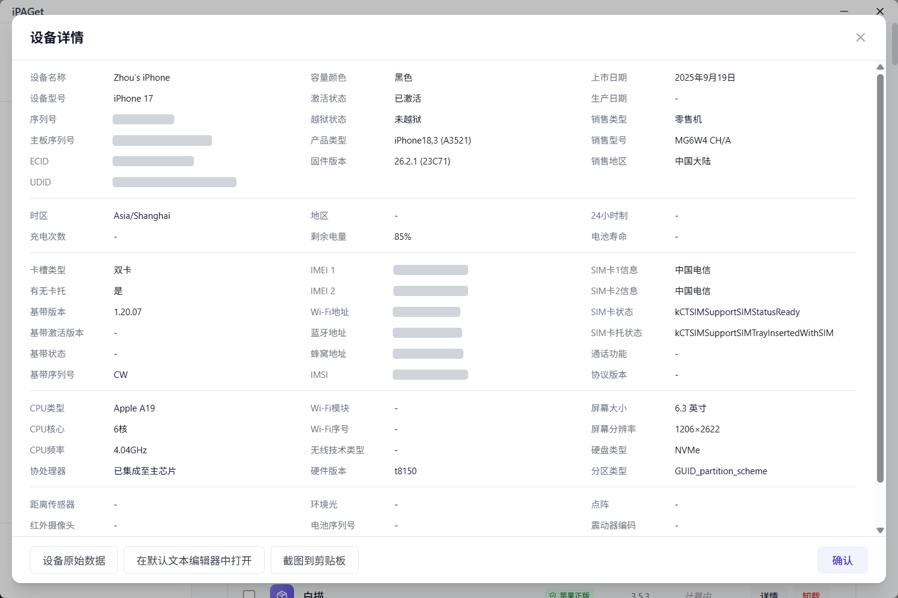
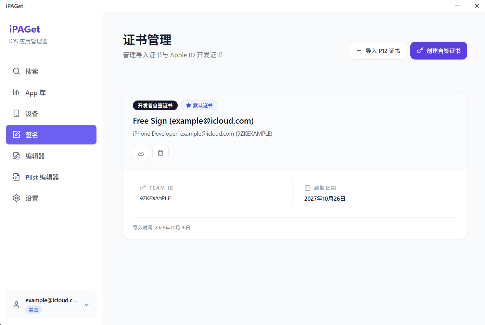
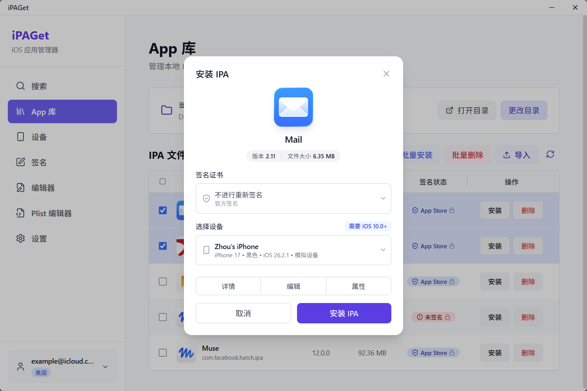
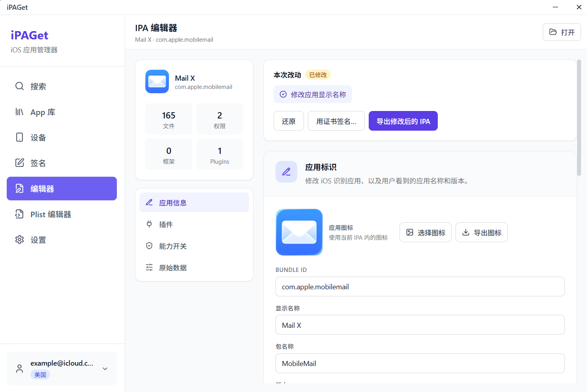
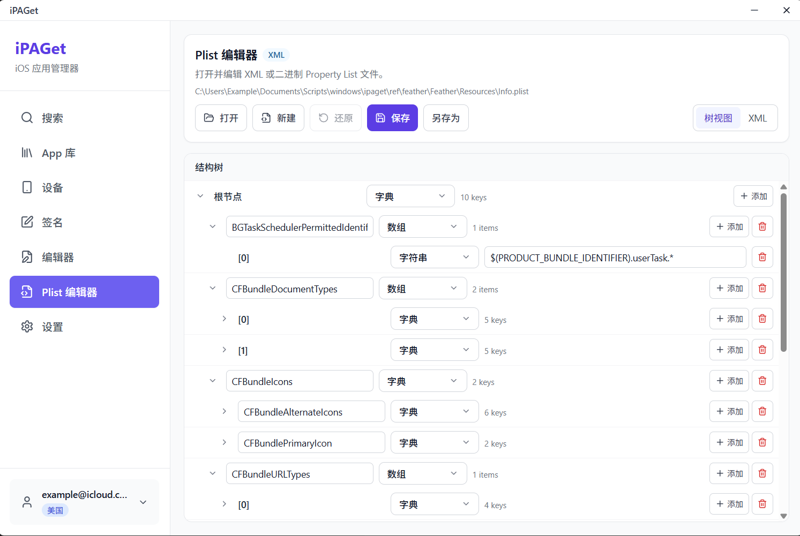

# iPAGet

**App Store 下载与 IPA 管理工具**

[](https://github.com/ipaget/ipaget/actions/workflows/build.yml)
[](https://github.com/ipaget/ipaget/releases)
[](https://github.com/ipaget/ipaget/releases)
[](LICENSE)
[](#下载)
[](https://github.com/ipaget/ipaget)
[English](README.md) · [下载](#下载) · [功能](#功能) · [界面截图](#界面截图) · [从源码构建](#从源码构建)

iPAGet 用于在电脑上下载、保存和管理 iPhone、iPad 应用，支持 Windows、macOS 和 Linux。

你可以将 App Store 应用下载为 IPA 文件，从版本历史中选择旧版，也可以连接设备，
下载与设备当前安装版本一致的 IPA。安装包保存在本地，方便留存和重装。

除了下载，iPAGet 还提供设备应用管理、IPA 编辑、证书管理和重新签名功能。

---

## 下载

在 [Releases](https://github.com/ipaget/ipaget/releases/latest) 下载对应系统的文件。同一系统的
几种格式是不同的安装方式，选择一种即可：

| 系统 | 推荐 | 其他选择 |
| --- | --- | --- |
| Windows 10/11 64 位 | `iPAGet_<版本>_windows-x64.msi` | `iPAGet_<版本>_windows-x64-setup.exe`（NSIS 安装包）、`iPAGet_<版本>_windows-x64-portable.exe` |
| Windows 10/11 32 位 | `iPAGet_<版本>_windows-x86.msi` | `iPAGet_<版本>_windows-x86-setup.exe`、`iPAGet_<版本>_windows-x86-portable.exe` |
| macOS（Apple Silicon / Intel） | `iPAGet_<版本>_macos-universal.dmg` | `iPAGet_<版本>_macos-universal.app.zip`（仅在 DMG 缺失时使用） |
| Linux x86_64 | `iPAGet_<版本>_linux-amd64.AppImage` | `iPAGet_<版本>_linux-amd64-portable` |

Windows 的 `.msi` 和 `-setup.exe` 都是安装包，`-portable.exe` 是免安装版；macOS 的
Universal 包同时支持 Apple Silicon 和 Intel。

安装注意事项：

- **macOS** 版本未做签名与公证。首次打开请 **右键 → 打开**，或执行
  `xattr -dr com.apple.quarantine /Applications/iPAGet.app`。
- **Windows** 版本未签名，可能出现 SmartScreen 提示。确认文件来自本仓库的 Release 后，
  选择 **更多信息 → 仍要运行**。
- **Linux** 的 AppImage 需要先 `chmod +x iPAGet_<版本>_linux-amd64.AppImage` 再运行。它在
  Ubuntu 24.04 上构建，需要 glibc 2.39 或更高版本（Ubuntu 24.04+、Debian 13+、Fedora 40+）。

---

## 功能

### 下载与版本管理

- 按商店地区搜索应用，查看榜单、应用详情和更新说明。
- 下载最新版，或从版本历史中选择指定版本。
- 读取设备上已装应用的 App Store 构建标识，下载同一构建的 IPA；这是从 Apple 重新下载，
  不是从设备导出安装包。
- 支持多个 Apple 账号，显示下载进度与速度，在本地应用库中管理下载或导入的 IPA。

### 设备应用管理

- 查看设备信息、已安装应用及其存储占用。
- 安装 IPA、卸载应用，浏览应用允许访问的文件容器并传输文件。

### IPA 查看与编辑

- 查看包标识、版本与构建号、最低系统要求、描述文件、授权项、框架和加密状态。
- 修改应用显示名称、图标及 `Info.plist`，导出修改后的 IPA。
- 使用树形视图或 XML 编辑属性列表，支持 XML 与二进制 Plist。

### 证书与签名

- 导入已有证书，或通过 Apple 开发者账号申请签名证书。
- 使用证书和描述文件为 IPA 签名或重新签名。

---

## 界面截图

| App Store 搜索 | 本地应用库 |
| :-: | :-: |
|  |  |
| 按地区搜索应用与浏览榜单 | 管理本地 IPA，批量安装或删除 |
| **应用详情** | **版本历史** |
|  |  |
| 查看应用信息和更新说明 | 选择历史版本下载 |
| **设备应用** | **设备信息** |
|  |  |
| 查看、安装和卸载应用 | 查看系统与硬件信息，设备标识已打码 |
| **证书管理** | **IPA 安装** |
|  |  |
| 管理开发者证书与自签证书 | 选择目标设备与签名选项 |
| **IPA 编辑器** | **Plist 编辑器** |
|  |  |
| 修改应用名称、图标和配置 | 查看和编辑属性列表 |

---

## 开始使用

1. **下载应用**：登录 Apple 账号并完成两步验证，搜索应用，在详情页下载最新版或选择历史版本。
2. **管理 IPA**：在应用库中查看下载的安装包，也可以导入已有 IPA，查看内容或进行编辑。
3. **连接设备**：通过 USB 连接 iPhone 或 iPad，解锁并选择 **信任此电脑**，然后在设备页管理应用或安装 IPA。

下载 IPA 不需要连接设备；查看本地 IPA 和常规设备操作不需要登录 Apple 账号。
如果需要代理，可在 **设置** 中配置。

### 使用限制

- **旧版本不保证始终可用。** 版本列表和下载结果取决于 Apple 仍提供哪些构建，以及当前账号的授权。
  下载设备已装版本时，还需要应用提供可用的版本标识。
- **IPA 不等于通用安装包。** App Store 下载受账号授权与 DRM 限制，重新签名不会解除 DRM。
  安装和运行还需满足设备系统、证书与描述文件的要求。
- **不需要越狱，但仍受 iOS 权限限制。** 文件浏览范围由系统和应用决定，不能访问任意应用的全部数据。
- **部分 iOS 17+ 操作需要隧道及管理员权限。** Windows 需在应用目录提供 `wintun.dll`；
  macOS 和 Linux 的隧道操作需要 `sudo` 权限。
- **App Store 下载直接向 Apple 请求。** 开发者账号认证可能使用设置中指定的 Anisette 服务，
  请确认服务来源可信。

---

## 从源码构建

需要 **Node 20+** 与 **pnpm 9**、**Rust**（stable）、**Go 1.25+**，以及所在平台的
[Tauri 系统依赖](https://v2.tauri.app/start/prerequisites/)（Linux 需 WebKitGTK 4.1 与
`libwebkit2gtk-4.1-dev`，macOS 需 Xcode 命令行工具，Windows 需 MSVC 构建工具）。

```bash
git clone https://github.com/ipaget/ipaget.git
cd ipaget
git submodule update --init go-service/vendors/go-ios   # go.mod 的替换目录，必需
pnpm install
pnpm tauri:dev                                          # Vite + Tauri，Go 服务热重载
```

`pnpm tauri:dev` 会启动 Vite 开发服务器与桌面窗口，Go 服务由 Rust 侧通过 `air` 启动，改动
Go 代码无需重启窗口。开发用的守护脚本会在应用自重启时保持 Vite 不中断。

本地打包：

```bash
pnpm tauri build        # 先执行 scripts/prebuild.mjs（前端 + Go 服务），再生成安装包
```

自检命令：

```bash
cd go-service && go test ./internal/... && go build ./...
npx tsc --noEmit
node --experimental-strip-types --test scripts/subtitle-scheduler.test.mjs
```

Linux 构建依赖（与 CI 使用的一致）：

```bash
sudo apt-get install -y libgtk-3-dev libayatana-appindicator3-dev libwebkit2gtk-4.1-dev \
  patchelf librsvg2-dev desktop-file-utils appstream libpipewire-0.3-dev libdbus-1-dev \
  libxcb1-dev libxcb-randr0-dev libxcb-shm0-dev libxcb-xfixes0-dev libxcb-shape0-dev \
  libxrandr-dev libgbm-dev libdrm-dev libwayland-dev libxkbcommon-dev libegl1-mesa-dev \
  libxdo-dev libssl-dev pkg-config
```

---

## 目录结构

| 路径 | 内容 |
| --- | --- |
| `src/` | React 界面：页面、组件、状态管理与 `zh` / `en` 文案 |
| `src-tauri/` | Tauri 外壳：窗口与启动流程、文件系统与桌面命令、打包配置 |
| `go-service/` | Go 服务：App Store 访问、设备通信、IPA 解析、签名、日志推送 |
| `docs/images/zh` | 中文 README 使用的截图 |
| `docs/images/en` | 英文 README 使用的截图 |
| `scripts/` | 开发运行器、开发重启守护与发布前构建脚本 |
| `ref/` | 实现协议时参考的源码，不参与构建 |

界面与服务之间通过本机 HTTP 接口通信，日志走 WebSocket；服务随应用一起分发，无需额外安装。

---

## 常见问题

| 现象 | 处理方式 |
| --- | --- |
| 登录后仍反复要求验证码 | 会话被清除或已过期。打开 **调试 → 登录会话** 查看已保存内容，必要时清除后重新登录。 |
| 找不到设备 | 重新插拔数据线、在设备上选择“信任此电脑”并解锁；Windows 上确认已安装 Apple 的 USB 驱动。 |
| iOS 17+ 安装或浏览失败 | 以管理员权限启动隧道（Windows 需要 `wintun.dll`，macOS/Linux 需要 `sudo`）。 |
| 首次查询版本历史要等约一分钟 | App Store 需要先完成带签名的下载授权握手才能列出构建版本；结果会缓存一小时，对话框内可手动刷新。 |
| 下载报连接错误 | **设置** 中的代理不可达会阻断 App Store 请求，清除或换用可用代理。 |
| macOS 无法打开应用 | 按上文右键 **打开**，或移除隔离属性。 |

---

## 许可证

本项目采用 **CC BY-NC-SA 4.0**，详见 [LICENSE](LICENSE)。允许非商业用途的使用、修改与
分发，但必须保留署名，且衍生作品需采用相同许可证。该许可证不允许商业用途。

---

## 致谢

iPAGet 建立在以下项目之上：

- [ipatool](https://github.com/majd/ipatool) —— App Store 登录与下载协议
- [go-ios](https://github.com/danielpaulus/go-ios) —— 通过 usbmux 与 lockdown 与设备通信
- [Tauri](https://v2.tauri.app/)、[React](https://react.dev/) 与 [Vite](https://vite.dev/) —— 桌面外壳与界面
- `ref/` 下的参考项目，实现协议时用于比对

Apple、App Store、iPhone、iPad 是 Apple Inc. 的商标，本项目与 Apple 无隶属关系。
