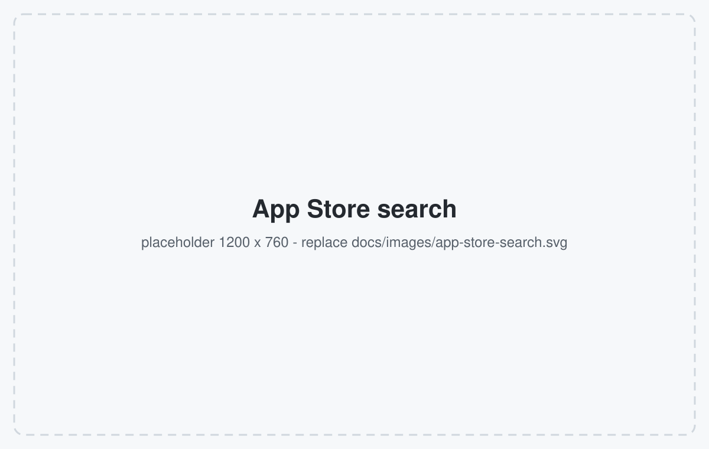
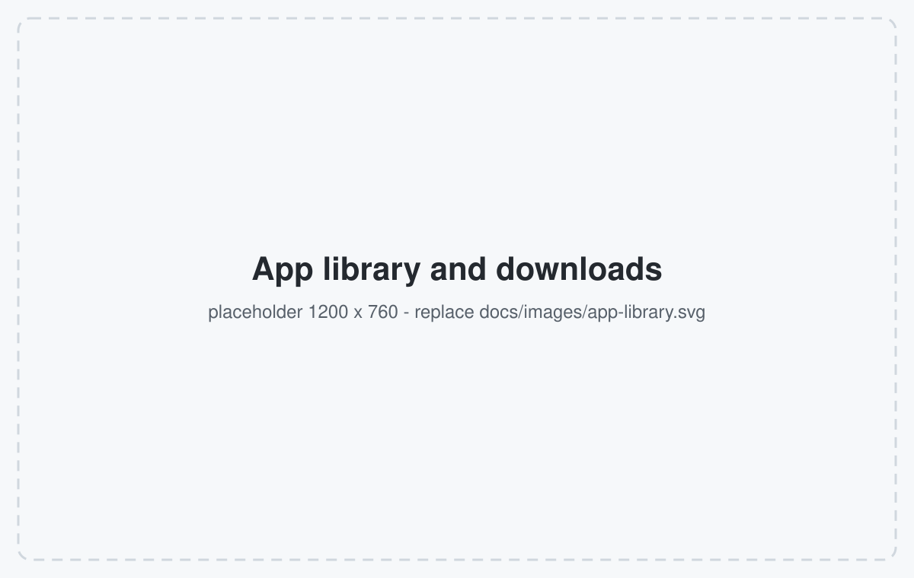
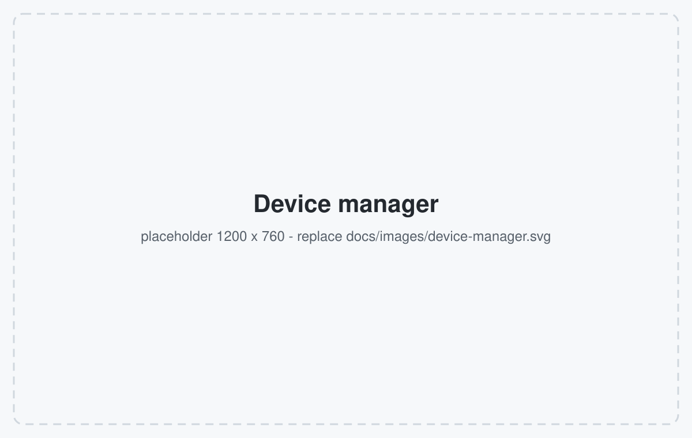
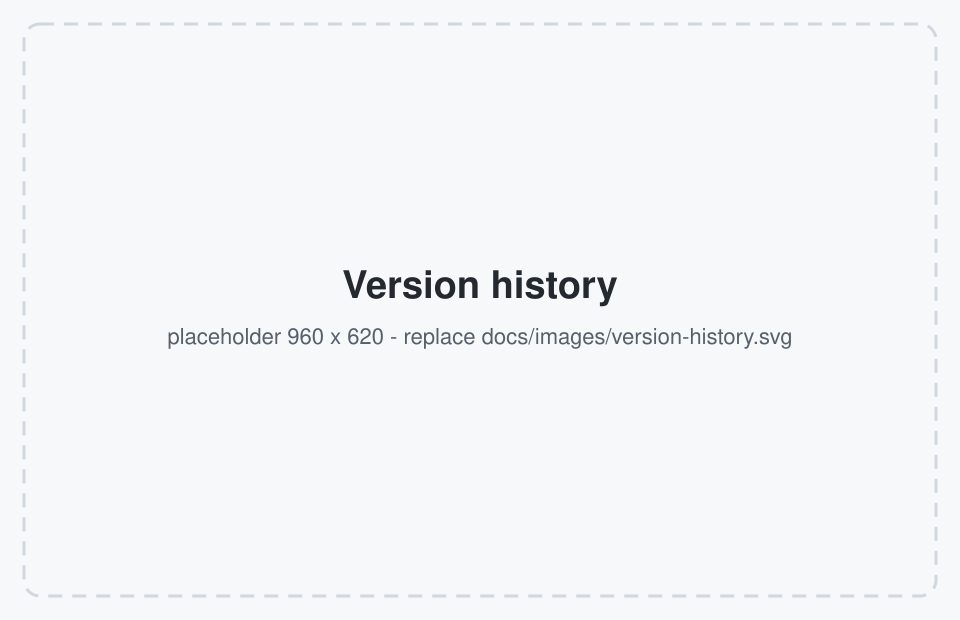
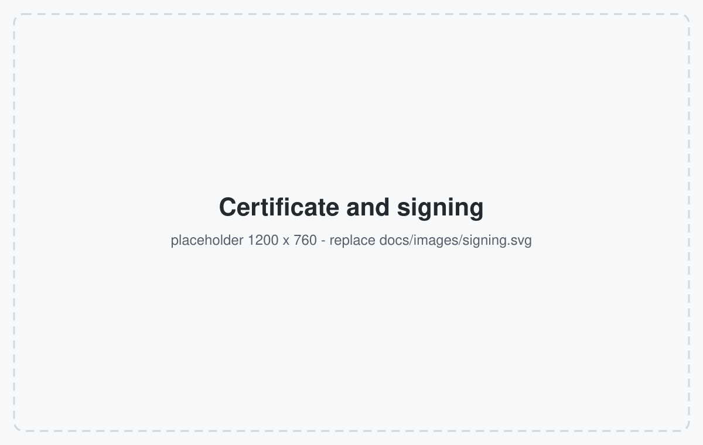
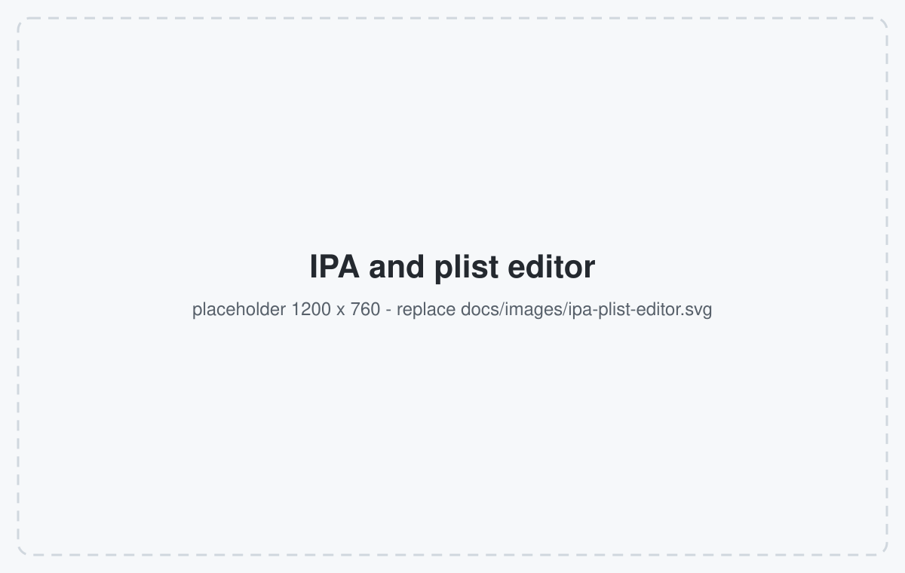

# iPAGet

**在电脑上管理 iPhone 与 iPad 的应用 —— 支持 Windows、macOS 和 Linux。**

[](https://github.com/ipaget/ipaget/actions/workflows/build.yml)
[](https://github.com/ipaget/ipaget/releases)
[](https://github.com/ipaget/ipaget/pulls)
<!-- 发布 Release 后下载计数徽章才有效，可替换上面的 commits 徽章：
[](https://github.com/ipaget/ipaget/releases) -->
[](LICENSE)
[](#下载)
[](https://github.com/ipaget/ipaget)
[](https://github.com/ipaget/ipaget/issues)
[](https://github.com/ipaget/ipaget/commits/master)

[](https://v2.tauri.app/)
[](https://www.rust-lang.org/)
[](https://go.dev/)
[](https://react.dev/)
[](https://www.typescriptlang.org/)

[English README](README.md)

iPAGet 把设备上的应用集中到一个窗口里管理：搜索 App Store、下载指定版本、安装到已
连接的设备，或用自己的证书重新签名。所有操作都在本机完成，直接与 Apple 通信，不经过
任何第三方服务。

---

## 界面截图

| | |
| :-: | :-: |
|  |  |
| 切换商店地区搜索，查看榜单与应用详情 | 已下载的 IPA，显示进度与传输速度 |
|  |  |
| 已装应用、占用空间、设备信息与文件浏览 | 完整版本历史，选择需要的构建版本 |
|  |  |
| 管理开发者账号证书，签名或重签 IPA | 查看包内信息，以树形视图编辑 plist |

> 上图为占位图。把真实截图放进 `docs/images/` 并使用相同文件名（例如
> `docs/images/app-store-search.png`），再更新本节的链接即可。首图对应
> `docs/images/hero.svg`（建议尺寸 1600 × 520）。

---

## 下载

在 [最新发布](https://github.com/ipaget/ipaget/releases) 中选择对应系统的文件。Windows 与
Linux 的文件名包含版本号，例如 `iPAGet_1.0.0_x64_en-US.msi`。

| 系统 | 推荐 | 其他选择 |
| --- | --- | --- |
| Windows 10/11 64 位 | `iPAGet_<版本>_x64_en-US.msi` | `..._x64-setup.exe`（NSIS 安装包）、`iPAGet_windows-x64_portable.exe` |
| Windows 10/11 32 位 | `iPAGet_<版本>_x86_en-US.msi` | `..._x86-setup.exe`、`iPAGet_windows-x86_portable.exe` |
| macOS（任意机型） | `universal-macOS-Universal.dmg` | `iPAGet_<版本>_aarch64.dmg`（Apple 芯片）、`iPAGet_<版本>_x64.dmg`（Intel）、`macos-arm64.app.zip`、`macos-x64.app.zip` |
| Linux 64 位 | `iPAGet_<版本>_amd64.AppImage` | `iPAGet_linux-amd64-portable` |

安装提示：

- **macOS** 版本未做签名与公证。首次打开请 **右键 → 打开**，或执行
  `xattr -dr com.apple.quarantine /Applications/iPAGet.app`。
- **Windows** 同样会提示 SmartScreen，选择 **更多信息 → 仍要运行** 即可。
- **Linux** 的 AppImage 需要先 `chmod +x iPAGet_<版本>_amd64.AppImage` 再运行。它在
  Ubuntu 24.04 上构建，需要 glibc 2.39 或更高版本（Ubuntu 24.04+、Debian 13+、Fedora 40+）。

---

## 主要功能

### 浏览与下载

- 切换商店地区搜索应用（美国、中国、日本、英国等），查看榜单、副标题、评分与分类。
- 打开应用详情页，或直接进入该应用的 IPA 下载。
- 查看完整的**版本历史**，下载指定构建版本 —— 包括**设备上当前安装的那一版**（按 App Store
  的构建标识精确匹配）。
- 同时保留多个 Apple 账号；登录状态会缓存，不必每次启动都重新验证。
- 下载过程显示进度、已传输大小与速度，下载完成的 IPA 收进应用库统一管理。

### 设备管理

- 查看已连接设备的机型、系统版本、存储、电池与连接信息。
- 列出设备上已安装的应用，包括占用空间与共享的应用组数据。
- 读取已安装应用中记录的 App Store 标识，据此下载完全相同的版本。
- 安装 IPA、卸载应用，浏览应用的文件容器并上传或下载文件。

### IPA 处理

- 安装前先看清包内容：包标识符、版本与构建号、最低系统要求、支持的设备、内嵌描述
  文件、授权项、动态库与框架，以及可执行文件是否加密。
- 以树形视图或原始 XML 编辑 `Info.plist` 等属性列表。

### 签名

- 管理 Apple 开发者账号中的证书（免费或付费账号均可）：生成签名请求并签发新证书，或导入
  已有证书。
- 用证书与描述文件对 IPA 签名或重签，以便安装到设备。
- 凭据与密钥保存在系统钥匙串中，应用不会把数据存到任何服务器。

---

## 使用前提

- 涉及 App Store 的功能需要 Apple 账号；纯设备功能（已装应用列表、文件浏览、安装已有 IPA）
  不需要登录。
- 需要一台已配对并在设备上信任过本机的 iOS 设备，用 USB 连接。
- iOS 17 及以上设备的部分操作需要 usbmux 隧道，需管理员权限：Windows 上把 `wintun.dll`
  放在应用目录，macOS 与 Linux 上以 `sudo` 运行。
- 如需代理，在 **设置** 中填写。代理对后续请求立即生效，无需重启应用。

---

## 从源码构建

需要 **Node 20+** 与 **pnpm 9**、**Rust**（stable）、**Go 1.25+**，以及所在平台的
[Tauri 系统依赖](https://v2.tauri.app/start/prerequisites/)（Linux 需 WebKitGTK 4.1 与
`libwebkit2gtk-4.1-dev`，macOS 需 Xcode 命令行工具，Windows 需 MSVC 构建工具）。

```bash
git clone https://github.com/ipaget/ipaget.git
cd ipaget
git submodule update --init go-service/vendors/go-ios   # go.mod 的替换目录，必需
pnpm install
pnpm tauri:dev                                          # Vite + Tauri，Go 服务热重载
```

`pnpm tauri:dev` 会启动 Vite 开发服务器与桌面窗口，Go 服务由 Rust 侧通过 `air` 启动，改动
Go 代码无需重启窗口。开发用的守护脚本会在应用自重启时保持 Vite 不中断。

本地打包：

```bash
pnpm tauri build        # 先执行 scripts/prebuild.mjs（前端 + Go 服务），再生成安装包
```

自检命令：

```bash
cd go-service && go test ./internal/... && go build ./...
npx tsc --noEmit
node --experimental-strip-types --test scripts/subtitle-scheduler.test.mjs
```

Linux 构建依赖（与 CI 使用的一致）：

```bash
sudo apt-get install -y libgtk-3-dev libayatana-appindicator3-dev libwebkit2gtk-4.1-dev \
  patchelf librsvg2-dev desktop-file-utils appstream libpipewire-0.3-dev libdbus-1-dev \
  libxcb1-dev libxcb-randr0-dev libxcb-shm0-dev libxcb-xfixes0-dev libxcb-shape0-dev \
  libxrandr-dev libgbm-dev libdrm-dev libwayland-dev libxkbcommon-dev libegl1-mesa-dev \
  libxdo-dev libssl-dev pkg-config
```

---

## 目录结构

| 路径 | 内容 |
| --- | --- |
| `src/` | React 界面：页面、组件、状态管理与 `zh` / `en` 文案 |
| `src-tauri/` | Tauri 外壳：窗口与启动流程、文件系统与桌面命令、打包配置 |
| `go-service/` | Go 服务：App Store 访问、设备通信、IPA 解析、签名、日志推送 |
| `docs/images/` | 本 README 使用的截图 |
| `scripts/` | 开发运行器、开发重启守护与发布前构建脚本 |
| `ref/` | 实现协议时参考的源码，不参与构建 |

界面与服务之间通过本机 HTTP 接口通信，日志走 WebSocket；服务随应用一起分发，无需额外安装。

---

## 常见问题

| 现象 | 处理方式 |
| --- | --- |
| 登录后仍反复要求验证码 | 会话被清除或已过期。打开 **调试 → 登录会话** 查看已保存内容，必要时清除后重新登录。 |
| 找不到设备 | 重新插拔数据线、在设备上选择“信任此电脑”并解锁；Windows 上确认已安装 Apple 的 USB 驱动。 |
| iOS 17+ 安装或浏览失败 | 以管理员权限启动隧道（Windows 需要 `wintun.dll`，macOS/Linux 需要 `sudo`）。 |
| 首次查询版本历史要等约一分钟 | App Store 需要先完成带签名的下载授权握手才能列出构建版本；结果会缓存一小时，对话框内可手动刷新。 |
| 下载报连接错误 | **设置** 中的代理不可达会阻断 App Store 请求，清除或换用可用代理。 |
| macOS 无法打开应用 | 按上文右键 **打开**，或移除隔离属性。 |

---

## 许可证

本项目采用 **CC BY-NC-SA 4.0**，详见 [LICENSE](LICENSE)。允许非商业用途的使用、修改与
分发，但必须保留署名，且衍生作品需采用相同许可证。该许可证不允许商业用途。

---

## 致谢

iPAGet 建立在以下项目之上：

- [ipatool](https://github.com/majd/ipatool) —— App Store 登录与下载协议
- [go-ios](https://github.com/danielpaulus/go-ios) —— 通过 usbmux 与 lockdown 与设备通信
- [Tauri](https://v2.tauri.app/)、[React](https://react.dev/) 与 [Vite](https://vite.dev/) —— 桌面外壳与界面
- `ref/` 下的参考项目，实现协议时用于比对

Apple、App Store、iPhone、iPad 是 Apple Inc. 的商标，本项目与 Apple 无隶属关系。
